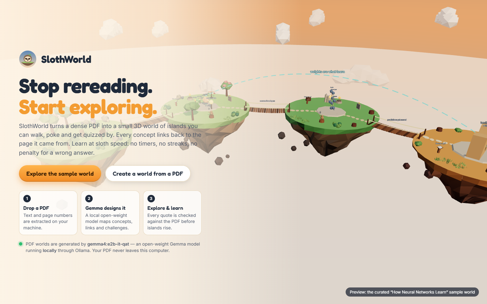
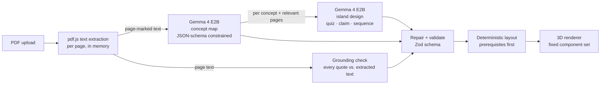

# SlothWorld 🦥

**Stop rereading. Start exploring.**

SlothWorld turns a dense PDF into a small 3D world of islands you can walk around, experiment in and get quizzed by. A **local open-weight model (Gemma 4 E2B via Ollama)** reads the document and designs the world. Then every quote it cites is checked against the PDF before any island appears.



> Hacktoberfest 2026 · Week 3 submission. Runs entirely on a laptop: no cloud APIs, no accounts, and your PDF never leaves your machine.

---

## What you can do

| | |
|---|---|
| **Explore the curated sample world** | *How Neural Networks Learn*: three islands with real, working math. Tune a neuron's weights and watch its output change, send a signal through a 3→4→2 network, and train a model by gradient descent down a loss valley. Works offline, with no model required. |
| **Create a world from your own PDF** | Drop in lecture notes or a chapter. Gemma maps the key concepts and how they connect, then designs a quiz, a claim check and (when the text describes a process) a sequencing puzzle for each concept island. You can jump from any island to the exact PDF page that supports it. |


## Learn by doing, with a small cast

Each part is based on what learning research rates highly: practice testing and spaced practice are "high utility", while rereading and highlighting are "low" (Dunlosky et al., 2013).

- **Pip the baby sloth (teach-back):** explain each concept to Pip in your own words. Gemma checks your explanation against key sentences taken word-for-word from your PDF, and Pip asks *one* curious question about what you missed, without giving it away. This is the "protégé effect": people try harder when they teach (Chase et al., 2009). Without a model, it becomes a self-check against those same sentences.
- **Professor Hoot (questions answered from your PDF only):** press `H` anywhere. Hoot answers from the relevant pages and shows a quote that SlothWorld verifies against the PDF. If the PDF doesn't cover it, Hoot says so. Even without a model, Hoot shows the most relevant passages.
- **Word Bridge:** put the key terms back into a real sentence from your PDF. This is built by code, not by the model, so it's always grounded.
- **Review Grove (spaced recall):** solved challenges come back after 10 minutes, then 1, 3, 7 and 21 days; a miss restarts the ladder. Evidence appears *after* you answer, so you actually retrieve.
- **Gentle guidance:** a *Next step* button walks the sloth across bridges to your next challenge, and islands bloom with flowers as you solve things.

## Quick start

**Requirements:** Node.js 20+ (tested on 24.13), and for PDF worlds [Ollama](https://ollama.com) with the Gemma model.

```bash
npm install
npm run dev            # API on 127.0.0.1:8787 + app on http://localhost:5173
```

Open http://localhost:5173 and click **Explore the sample world**. This needs nothing else.

To enable **PDF → world** generation:

```bash
ollama pull gemma4:e2b-it-qat     # ~4.3 GB, one time
# Ollama must be running (it starts automatically on most installs)
```

The landing page shows a live status dot. It is green when the model is ready, and it tells you exactly what's missing when it isn't.

**Public deployment on Render** (Docker, `gemma3:1b` on CPU, rate-limited): see [docs/DEPLOY_RENDER.md](docs/DEPLOY_RENDER.md).

Production build (one process serves the app and the API):

```bash
npm run build
npm start                         # http://127.0.0.1:8787
```

Configuration (environment variables, all optional):

| Variable | Default | Purpose |
|---|---|---|
| `SLOTH_MODEL` | `gemma4:e2b-it-qat` | Any Ollama model that supports structured JSON output |
| `OLLAMA_URL` | `http://127.0.0.1:11434` | Where Ollama listens |
| `SLOTH_CALL_TIMEOUT_MS` | `240000` | Per-model-call timeout |
| `PORT` / `HOST` | `8787` / `127.0.0.1` | API server (local-only by default) |
| `SLOTH_HOSTED` | off | `1` = deployed for others: hosted privacy wording, trust proxy IPs |
| `SLOTH_RATE_LIMIT_PER_HOUR` | `0` | New worlds per visitor per hour (0 = unlimited) |
| `SLOTH_MAX_CONCEPTS` | `6` | Islands per world (2–6) |
| `SLOTH_NUM_THREAD` / `SLOTH_NUM_GPU` / `SLOTH_NUM_CTX` | Ollama defaults / – / `8192` | CPU threads, `0` = CPU only, context size |

### What runs where

| Part | Runs | Needs |
|---|---|---|
| 3D world, sample world, labs, quizzes, progress | In your browser | Nothing beyond the app |
| PDF text extraction (pdf.js) | Local Node server, in memory | Nothing extra |
| Concept mapping and island design | Local Ollama | `gemma4:e2b-it-qat` pulled (~4.3 GB, ~3.5 GB VRAM/RAM) |
| Saved worlds and progress | Browser `localStorage` | Nothing |

## How it works



```
 browser (React + React Three Fiber)          local server (Node + Express)         Ollama
 ┌─────────────────────────────────┐  PDF   ┌──────────────────────────────┐  JSON  ┌────────────┐
 │ Landing · Upload · 3D world     │ ─────▶ │ pdf.js extraction            │ ─────▶ │ gemma4:e2b │
 │ HUD · Journal · Labs · Panels   │ ◀───── │ prompts · repair · grounding │ ◀───── │  (local)   │
 │ localStorage (worlds, progress) │ NDJSON │ Zod validation · layout      │        └────────────┘
 └─────────────────────────────────┘ stages └──────────────────────────────┘
```

### The PDF-to-world pipeline

1. **Extract.** pdf.js reads the PDF in memory (no temp files) and keeps page numbers. Limits: 15 MB, first 60 pages. Encrypted, empty and scanned PDFs get specific, actionable errors. There is no OCR, and the app says so.
2. **Map the concepts** (model call 1). Page-marked text is fitted into a ~14k-character digest that samples every page. Gemma returns 4–6 concepts with explanations, a cited page and a verbatim quote, prerequisites, typed relationships, learning objectives and *uncertainties* (what the document leaves unclear). The output is constrained with Ollama's JSON-schema `format`.
3. **Design the islands** (one model call per concept). Each call gets only the pages relevant to that concept and returns an island title, purpose, objective, biome, a multiple-choice quiz, a claim to judge (alternating true and false), and an ordered sequence *only if the text describes one*. It also returns any explanation that goes **beyond the source**.
4. **Repair and validate.** The model output is treated as untrusted. Markup is stripped, duplicate or out-of-range quiz options are repaired or dropped, step labels are cleaned, unknown relationship targets are discarded, and "false" claims that appear word-for-word in the PDF are dropped. **Answer keys are checked:** a quiz is dropped if a different option matches the cited PDF passage, or the model's own explanation, better than the keyed answer. Islands whose design failed fall back to a question built only from already-validated concept summaries. The result must pass a strict Zod schema, or it isn't rendered.
5. **Ground every citation.** Each quote is searched for in the extracted text and labelled **verified**, **relocated** (page number corrected), **approximate** (closest matching sentence linked and marked as such) or **unverified** (flagged in red). The passage shown to learners always comes from the extraction, never from the model.
6. **Lay out the world.** A topological sort puts prerequisites before advanced concepts, keeps related concepts adjacent, links consecutive islands with walkable bridges and shows other relationships as labelled sky arcs. Placement is seeded, so the same blueprint always produces the same world.
7. **Render.** The blueprint maps onto a fixed set of components: islands, bridges, concept monuments, Riddle Stones (quiz), Scales of Truth (claim check), Sequence Steps (ordering), Pairing Totems (matching review), Source Lecterns and sky links. The model supplies data only, never code, HTML or scripts.

On a GTX 1660 Ti laptop, a 3–4 page PDF becomes a 5-island world in about **45–95 seconds**, including the model's first load.

### Why open-weight AI matters here

- **Privacy.** The documents people study (lecture notes, papers, internal reports) never leave the machine. The server binds to `127.0.0.1` and calls a local runtime.
- **Control and reproducibility.** The model is a pinned, inspectable file (`ollama show gemma4:e2b-it-qat` reports an Apache 2.0 license). You can swap it with one environment variable, run it offline and get the same pipeline every time.
- **The model does the heavy lifting, not decoration.** Turning a document into a concept graph, objectives, island designs and grounded questions is the work a student or teacher would otherwise do by hand when they make notes, diagrams and practice questions.
- **Small models work when the system checks them.** A 4.6B model runs on a 6 GB laptop GPU. Schema-constrained output plus grounding and repair make it dependable enough to build a world on, and every place it slips is visible to the learner.

### Telling sources apart

| Label in the UI | Meaning |
|---|---|
| **Supported by the PDF** / Quote verified | The cited quote was found on that page |
| Verified · page number corrected | Found, but on a different page; the page was fixed |
| **AI interpretation** / Closest matching passage | The model paraphrased; the nearest real sentence is linked |
| **Not found in the PDF** | Nothing matched; the concept or challenge is flagged |
| *Explanation (written by the model)* | The model's wording, not a quote |
| **Beyond the source** (dashed purple box) | Extra explanation the model says isn't in the text |
| *What the source leaves unclear* | The model's listed uncertainties |
| Curated sample · hand-written | The sample world was written by hand, not by the model |

Each AI world also has a **validation report** in the journal that lists every repair and flag.

## The sample world: real math, not animations

All numbers come from [`shared/math.ts`](shared/math.ts) and are covered by unit tests.

- **Island 1 · The Neuron.** z = Σ wᵢxᵢ + b and sigmoid(z) are shown live. Tube thickness and colour encode each weight. Goals: make the neuron fire (≥ 0.90), go quiet (≤ 0.10) and balance at exactly 0.50.
- **Island 2 · The Network.** A 3→4→2 sigmoid network. Pulses travel layer by layer with brightness proportional to weight × activation. Results appear only when the signal arrives. Goal: find an input pattern that pushes Output A above 0.75 (only `100` and `101` do).
- **Island 3 · The Learning Arena.** Fit ŷ = w·x to four points. The table shows each error and the MSE, and the ball rolls along the real loss curve. Take gradient steps at learning rate 0.01, 0.05 or 0.14. At 0.14 the loss genuinely grows, because 0.14 > 2/15 ≈ 0.133, the divergence threshold for this data.

Each island also has a quiz, a claim check or a sequencing puzzle tied to a verified quote in the 4-page guide [`public/samples/how-neural-networks-learn.pdf`](public/samples/how-neural-networks-learn.pdf). Upload that same PDF to compare the hand-made world with Gemma's.

## Controls and accessibility

- `W A S D` / arrow keys to move, drag to look, scroll to zoom, click the ground to walk there
- `E` interact · `J` journal · `M` world map · `Esc` close
- **Non-3D navigation:** the journal has a clickable concept map and island list with *Travel here* and *Read concept* buttons. Every challenge works with mouse or keyboard alone.
- Progress saves automatically. *Exit* returns to the landing page without losing anything.

## Testing

```bash
npm test          # unit tests (Vitest)
npm run e2e       # end-to-end in Chrome against the running app (npm run dev first)
npm run e2e -- http://127.0.0.1:8787 --skip-ai   # against the production build, skip generation
```

**Unit tests (35):** Pip's guard against over-crediting, Hoot's quote checks, Word Bridge building, route finding, neuron, network and gradient math (including a finite-difference gradient check and the divergence threshold), quote grounding (verified, relocated, approximate, unverified), quiz answer-key checks, blueprint repair (malformed quizzes, markup stripping, false claims that are verbatim in the source, step cleaning), every curated reference verifying against the sample text, and deterministic, non-overlapping, fully walkable layouts.

**Hosted mode (5 checks, `e2e/hosted.ts`):** hosted privacy wording, a CPU-only `gemma3:1b` generation through the UI, and rate limiting.

**End-to-end (21 checks, Playwright driving the real app in Chrome):** Walk-me-there routing, the Word Bridge, teaching Pip with real Gemma feedback, Hoot's verified answers and refusals, and spaced review. Also landing, the sample world with `/api` blocked, keyboard movement and edge collision, neuron values against the math (including real slider input), quiz and claim feedback, network propagation timing and values, the ordering puzzle, gradient-descent MSE and divergence, highlighted source passages, journal travel and world map, progress persistence across reload, panels at 1280×720 and 1024×640, rejection of `.txt`, fake, scanned and empty PDFs, model-missing and runtime-offline errors (on separate server instances), **real PDF → Gemma → validated world generation**, and zero console errors.

Latest results are in [docs/TEST_RESULTS.md](docs/TEST_RESULTS.md). Screenshots in [`docs/screenshots/`](docs/screenshots) are produced by the e2e run.

## Demo

See [docs/DEMO.md](docs/DEMO.md) for a reproducible 3-minute demo script and screen-recording plan.

## Known limitations

- **No OCR.** Scanned or image-only PDFs are detected and rejected with instructions; they aren't read.
- **Long documents are sampled.** The model sees a ~14k-character digest that covers every page, plus focused excerpts per concept, so details in very long PDFs can be missed. Only the first 60 pages are used.
- **Small-model quality varies.** This matters most with `gemma3:1b` on the hosted demo: weak quizzes and some mislabelled claims (wrong answer keys are caught and dropped).
- **Gemma 4 E2B quality also varies.** Gemma 4 E2B sometimes paraphrases quotes (these get flagged as *approximate*), writes easy questions or picks odd island names. Validation catches structural errors, but it can't fully judge whether a question is pedagogically good.
- **Hand-built labs only in the sample.** Generated worlds use quizzes, claim checks, sequencing and matching. The neuron, network and loss labs are hand-built for the sample; the model does not invent simulations.
- **The original PDF link lasts one session.** "Open the original PDF at p. N" works right after upload; after a reload, saved worlds show the extracted page text instead.
- **One generation at a time** on the local GPU. Desktop browsers only, no mobile layout target.

## Project structure

```
shared/        blueprint schema (Zod), grounding, repair/assembly, layout, math, sample world
server/        Express API: pdf extraction, Ollama client, generation pipeline
src/three/     React Three Fiber scene: islands, bridges, decor, sloth, player/camera, labs, stations
src/ui/        landing, upload flow, HUD, panels, station cards, lab panels, journal
tests/         Vitest unit tests
e2e/           Playwright end-to-end acceptance run
scripts/       sample-PDF generator, CLI generation, visual tours
public/        curated low-poly nature models, font, sample PDFs
```

## Credits

- Low-poly nature models (trees, bushes, rocks, clouds) come from the author's earlier asset library. 13 of its 450+ models were kept; the culturally specific buildings, vehicles and characters didn't fit this world and were removed. Everything else (islands, bridges, labs, stations and the sloth) is procedural geometry.
- Fonts: Fredoka and Inter (SIL Open Font License), self-hosted.
- Built with React, Three.js, React Three Fiber, drei, Zustand, Zod, pdf.js, Express and Ollama.
