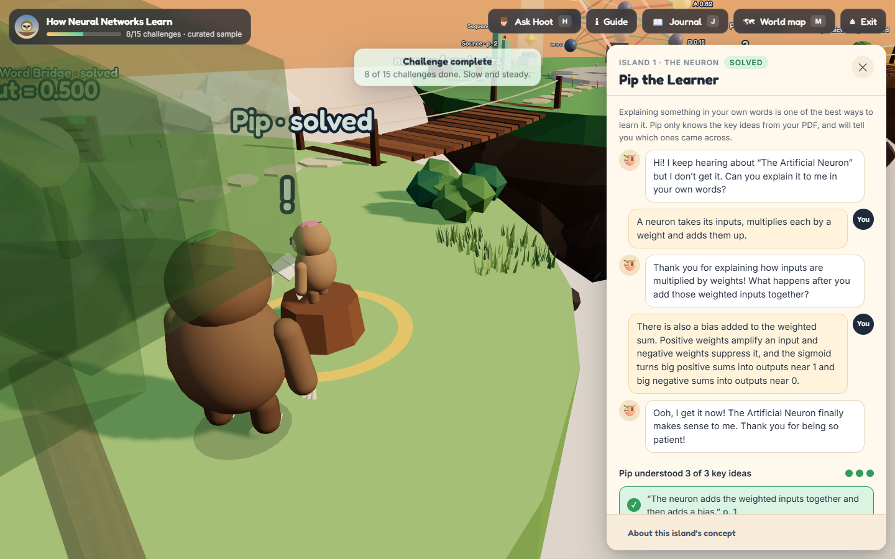
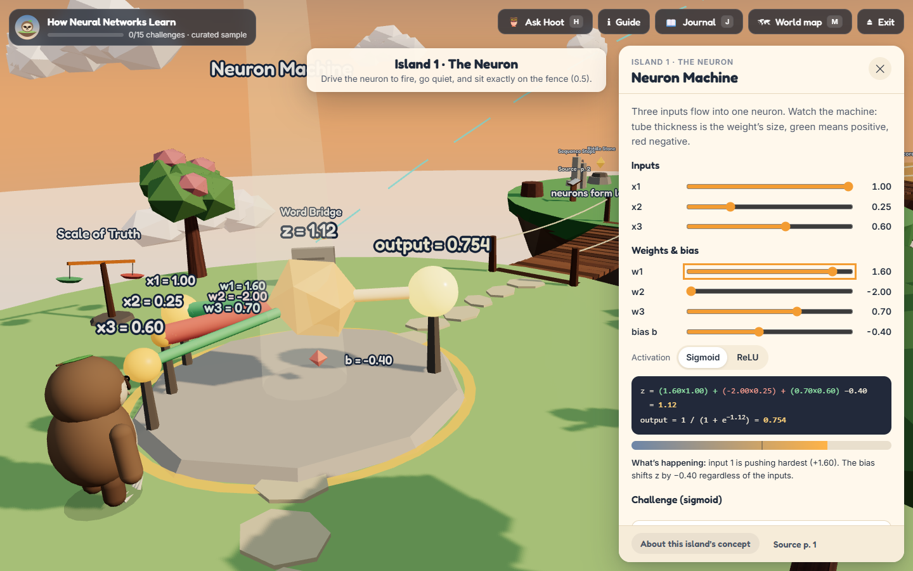
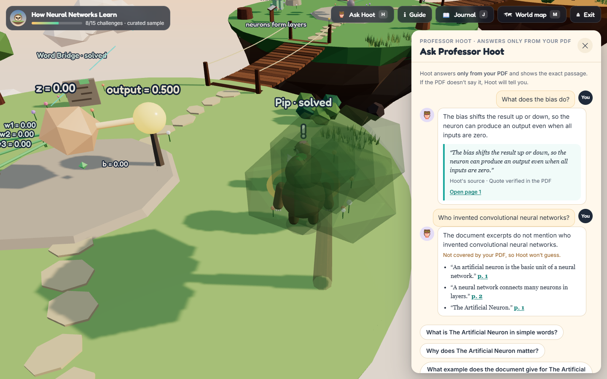

# SlothWorld 🦥

**Stop rereading. Start exploring.**

A 3D web game that turns a dense PDF into small islands you walk around, experiment on, and teach your way through, powered by Google's open Gemma models. Play it online, or run it entirely on your own laptop.

Created by Harichand for **Hacktoberfest 2026 · Week 3**. Entered in the **Gemma partner category**.

> **Try it now**
>
> 🌐 **Play online:** <!-- REPLACE with your Render URL --> *link coming soon* (the hosted demo runs Gemma 3 1B on Render)
>
> 🎬 **Watch the 3-minute demo:** <!-- REPLACE with your video link --> *coming soon*
>
> 💻 **Run it on your laptop in 2 minutes:** see [Install](#1-install)



- **Explore.** Each key idea in your PDF becomes an island. Bridges lead from the basics to the ideas that build on them. A *Walk me there* button takes the sloth to your next challenge.
- **Teach Pip.** On every island, Pip the baby sloth doesn't get the idea yet. You explain it in your own words. Pip checks which key sentences from your PDF came across, and asks one question about what you missed, without giving the answer away.
- **Ask Professor Hoot.** Press `H` anywhere. Hoot answers only from your PDF and shows the exact sentence, with a link to the page. If your PDF doesn't cover it, Hoot says so.
- **Practise.** Riddle Stones (quizzes), Scales of Truth (is this claim supported?), Sequence Steps (put a process in order) and Word Bridges (put the key words back into a real sentence from your PDF).
- **Remember.** What you solve comes back in the Review Grove after 10 minutes, then 1, 3, 7 and 21 days. A miss starts that item over.
- **Slow and steady.** No timers, no streaks, no penalty for a wrong answer. Your progress is saved, and islands bloom with flowers as you learn.
- **Private.** No account needed. Run it yourself and your PDF never leaves your computer.

## The theme: slow and steady

Studying a dense PDF is slow. SlothWorld doesn't pretend otherwise. It makes the slow part (actually understanding) feel calm and playful, and does the tedious part (turning pages into practice) for you.

- **No rush.** Nothing is timed, there are no streaks to protect, and a wrong answer just means "look again".
- **One island at a time.** Prerequisites come first, so you build understanding step by step.
- **Come back tomorrow.** The Review Grove spaces your practice over days, because a few minutes now and then beats one long cram.
- **The effort it saves:** a 4-page PDF becomes a world with about a dozen challenges in about a minute.

## Why it's built this way

Rereading, highlighting and summarising are rated among the *least* useful ways to study. Practice testing and spaced practice are rated the *most* useful ([Dunlosky et al., 2013](https://www.psychologicalscience.org/news/releases/which-study-strategies-make-the-grade.html)). Students also try harder when they teach someone, the "protégé effect" ([Chase et al., 2009](https://purl.stanford.edu/zm369yx3532)).

So SlothWorld doesn't summarise your PDF for you. It turns it into things to *do*: teach, answer, recall later.

## Partner technology: Gemma

SlothWorld uses Google's **Gemma** open models, running locally through [Ollama](https://ollama.com). Gemma is used for a few narrow jobs. It never writes code or HTML, and plain code checks everything it says against your PDF before you see it.

| Job | What Gemma does | What the code checks |
|---|---|---|
| **Map the concepts** | Reads the page-marked text and picks 4–6 key ideas, with explanations, prerequisites, how they connect, learning objectives, and what the PDF leaves unclear. Each idea comes with a page number and a quote. | Every quote is searched for in the PDF's actual text. Page numbers are corrected; quotes that aren't found are flagged in red. |
| **Design each island** | Writes a quiz, a true-or-false claim, and a sequence (only if the text describes one). | Bad options are repaired or dropped. **Answer keys are checked**: a quiz is dropped if another option matches the cited passage, or Gemma's own explanation, better than the keyed answer. |
| **Be Pip** | Judges which key ideas your explanation conveys, and asks one Socratic question. | Pip's key ideas are sentences copied from your PDF. An idea only counts if your explanation shares real vocabulary with it, so Pip can't be flattered by an off-topic answer. |
| **Be Hoot** | Answers your question from the relevant pages, with a quote. | The quote is verified against the PDF; a made-up one is labelled "could not be found". |

The Word Bridges and the Review Grove are built by code from verified sentences, with no model involved.

**Two Gemma models, each where it fits:**

| | Model | Runs on | A 3–4 page PDF takes |
|---|---|---|---|
| Your own computer (default) | **Gemma 4 E2B** (`gemma4:e2b-it-qat`, 4.6B, ~4.3 GB) | A laptop GPU (tested on a 6 GB GTX 1660 Ti) | ~45–110 s, 5 islands |
| The public demo on Render | **Gemma 3 1B** (`gemma3:1b`, ~815 MB) | 2 CPU cores, no GPU | ~3–6 min, 4 islands |

**What testing showed:** on CPU, Gemma 3 1B marked the wrong answer as correct on 5 of its 6 quizzes for one PDF. The answer-key check caught all 5. Run against earlier Gemma 4 output, it kept all 10 correct quizzes.

Everything the model writes is labelled as the model's in the app. Quotes show whether they were *verified*, had their *page corrected*, are only the *closest matching passage*, or were *not found*.

## 1. Install

You need **Node.js 20 or newer** ([nodejs.org](https://nodejs.org)) and **Git**.

```bash
git clone https://github.com/royalharry007/SlothWorld.git
cd SlothWorld
npm install
npm run build
npm start
```

Open **http://127.0.0.1:8787**. The sample world works right away, with no model needed.

**To create worlds from your own PDFs** (and to talk to Pip and Hoot), install [Ollama](https://ollama.com/download), then download Gemma once:

```bash
ollama pull gemma4:e2b-it-qat
```

The green dot on the start page shows when the model is ready. Without it, Pip turns into a self-check against the PDF's key sentences, and Hoot shows the most relevant passages instead of answering.

Tested on Windows 11 with Chrome. Other recent desktop browsers with WebGL should work, but haven't been tested.

## 2. Use it

**Explore the sample world**

1. Click **Explore the sample world**, then **Start exploring**.
2. Walk with `W A S D` or the arrow keys, drag to look around, scroll to zoom, or click the ground to walk there. **Walk me there** goes to your next challenge.
3. Walk up to something glowing and press `E`.

The sample, *How Neural Networks Learn*, is hand-written and labelled as such. Its three islands have working labs, and every number is calculated live:

- **The Neuron:** drag the weights, inputs and bias, and watch z = Σwx + b and sigmoid(z) change.
- **The Network:** send a signal through a 3→4→2 network and watch it travel.
- **The Learning Arena:** roll a ball down the real loss curve with gradient descent. A learning rate of 0.14 really does overshoot.



**Create a world from your PDF**

1. Click **Create a world from a PDF** and drop in a PDF (up to 15 MB; the first 60 pages are used).
2. Watch the stages: reading the PDF, mapping concepts, designing islands, checking quotes, raising islands.
3. Explore your new world. Press `J` for the journal (a clickable concept map and the **validation report** of everything that was fixed or flagged) and `M` for the world map.

No PDF handy? Try `public/samples/the-water-cycle.pdf`.



**Keys:** `E` use · `H` ask Hoot · `J` journal · `M` world map · `Esc` close.

## 3. Settings

All settings are optional environment variables:

| Variable | Default | What it does |
|---|---|---|
| `SLOTH_MODEL` | `gemma4:e2b-it-qat` | Any Ollama model that supports JSON output |
| `OLLAMA_URL` | `http://127.0.0.1:11434` | Where Ollama is listening |
| `SLOTH_MAX_CONCEPTS` | `6` | Islands per world (2–6). Fewer is faster |
| `SLOTH_NUM_THREAD` / `SLOTH_NUM_GPU` / `SLOTH_NUM_CTX` | Ollama's / – / `8192` | CPU threads, `0` = CPU only, context size |
| `SLOTH_CALL_TIMEOUT_MS` | `240000` | Time limit per model call |
| `SLOTH_HOSTED` | off | `1` when running for other people: changes the privacy wording |
| `SLOTH_RATE_LIMIT_PER_HOUR` / `SLOTH_TUTOR_LIMIT_PER_HOUR` | `0` (unlimited) | New worlds / Pip-and-Hoot questions per visitor per hour |
| `PORT` / `HOST` | `8787` / `127.0.0.1` | The server only listens on your own computer by default |

## 4. The live demo

The online version runs on **Render** in a single container: SlothWorld, Ollama and **Gemma 3 1B**, on plain CPUs with no GPU. That shows an open model can power the whole experience on modest hardware.

- **Same game, smaller model.** The sample world is instant. A world from your own PDF takes about 3–6 minutes on the server's CPU (versus about a minute with Gemma 4 on a laptop GPU), and the questions are simpler.
- **Honest about privacy.** Online, the app says your PDF is processed on the SlothWorld server, in memory, not stored, and not sent to any AI company. It only says "never leaves your computer" when you run it yourself.
- **Fair use.** Each visitor can build 3 worlds and ask Pip and Hoot 40 questions per hour, so everyone gets a turn.

## Safety

- **Nothing is executed.** The PDF is read as text in memory, and no temporary files are written. The model's output is data checked against a strict schema; it can't add code, HTML or new kinds of object.
- **Every quote is checked** against the text taken from your PDF. The passage you read is always the PDF's own words, never the model's.
- **Wrong answers are dropped, not hidden.** Quizzes whose answer key disagrees with the source are removed, and the journal's validation report lists every fix.
- **Honest failures.** Scanned PDFs (no OCR), password-protected files, a missing model and an offline model each give a clear message. The sample world always works.
- **Local by default.** The server listens only on `127.0.0.1`. Saved worlds and progress stay in your browser.

## Known limitations

- **No OCR.** Scanned PDFs are detected and refused, with instructions.
- **Long PDFs are sampled.** Some detail in long documents is missed.
- **Small models make mistakes.** Gemma 3 1B (used online) writes simpler questions and can mislabel a claim; the source passage is always shown after you answer.
- **The hands-on labs exist only in the sample world.** Generated worlds use quizzes, claims, sequences, Word Bridges, Pip and Hoot.
- **Low-memory computers** can lose the 3D view while the model is running. A **Wake the world up** button reloads it, and your progress is kept.

## For developers

**Run in development mode** (live reload):

```bash
npm run dev          # app on http://localhost:5173, API on 127.0.0.1:8787
```

**Run the tests:**

```bash
npm test             # 35 unit tests: math, quote checks, repairs, layout, Pip and Hoot guards
npm run e2e          # 21 end-to-end checks in Chrome against the running app (needs npm run dev)
npm run e2e -- http://127.0.0.1:8787 --skip-ai   # against the production build, without generation
```

The end-to-end run plays the game the way a learner would. It checks every lab's numbers against the math, walks the sloth between islands, teaches Pip and asks Hoot with the real model, uploads real, fake, scanned and empty files, and generates a world from a real PDF. Results are in [docs/TEST_RESULTS.md](docs/TEST_RESULTS.md).

**Deploy your own copy on Render:** `render.yaml` and the `Dockerfile` set everything up. In Render choose **New → Blueprint** and pick your fork. [docs/DEPLOY_RENDER.md](docs/DEPLOY_RENDER.md) covers every step, the costs, and how to suspend the service afterwards.

**Generate a world from the command line:**

```bash
npx tsx scripts/try-generate.ts public/samples/the-water-cycle.pdf world.json
```

**How the code is organised:**

```
shared/      world blueprint schema, quote checking, repairs, layout, math, sample world
server/      PDF reading, Ollama client, world generation, Pip and Hoot
src/three/   the 3D world: islands, bridges, the sloth and friends, labs, camera
src/ui/      landing page, upload, panels, challenge cards, journal
tests/ e2e/  unit and end-to-end tests
```

## License and credits

SlothWorld is created by Harichand and released under the [MIT License](LICENSE).

It builds on:

- **Gemma** by Google (Gemma 4 E2B, reported by Ollama as Apache 2.0; Gemma 3 1B under the Gemma Terms of Use), run locally with [Ollama](https://ollama.com). The models are downloaded on your computer, not included here.
- [React](https://react.dev), [three.js](https://threejs.org), [React Three Fiber](https://github.com/pmndrs/react-three-fiber) and drei, [pdf.js](https://mozilla.github.io/pdf.js/), [Zod](https://zod.dev), [Zustand](https://github.com/pmndrs/zustand), Express and Vite.
- Fonts: Fredoka and Inter (SIL Open Font License).
- Low-poly trees, bushes, rocks and clouds come from my earlier asset library. The islands, labs, characters and the sloth are generated in code.
